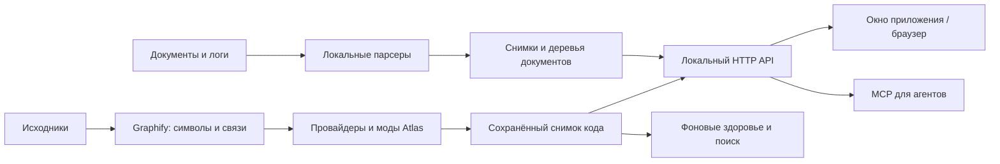

# Code Atlas

**Русский** · [English](README.en.md)

**Локальная карта кода и документов для разработчиков, аналитиков и AI-агентов.**

Atlas помогает понять незнакомый проект: найти начало операции, пройти по вызовам,
прочитать исходник, увидеть тесты и их данные, разобраться в зависимостях.
Приложение открывается в отдельном окне или браузере. Агенты Codex и Cursor
получают те же факты через MCP.

[Установка](docs/install.ru.md) · [Установка агентом](INSTALL_AGENT.md#русский) ·
[Быстрый старт](#быстрый-старт) · [Как пользоваться](#как-пользоваться) ·
[Устройство](#как-устроен-atlas) · [Библиотеки](#сторонние-библиотеки) ·
[Документация](#документация)

## Что можно делать

| Задача | Возможность Atlas |
| --- | --- |
| Изучить незнакомый сервис | Иерархия проектов, папок, файлов и символов; каталог точек входа |
| Понять операцию | Путь от входа, раскрытие методов, условия, циклы и переход к исходнику |
| Найти внешние зависимости | Статические факты об HTTP, Kafka, RabbitMQ, БД и таблицах, где их удалось определить |
| Разобраться в тестах | Аннотации, тестовые входы и объявленные источники данных через framework-моды |
| Оценить изменения | Сложность, здоровье, документация, структура файлов/папок и план изменений |
| Читать документы | Деревья Markdown, YAML, Helm, DOCX, XLSX, PPTX, PDF и логов |
| Работать с агентом | Поиск символов, чтение фактов и документов, оценка изменений, сохранение объясняющих карт через MCP |
| Настроить представление | Светлая/тёмная темы, свои цветовые схемы, карточки, действия и группировки через моды |

Карта — результат **статического анализа**. Она помогает исследовать исходники,
но не является трассировкой работающей системы. Неизвестные факты и усечение
показываются явно; отсутствие стрелки не доказывает отсутствие зависимости.

## Быстрый старт

[Полная инструкция RU](docs/install.ru.md) · [English installation guide](docs/install.en.md).
В ней — требования, первая карта, MCP, обновления и диагностика. Для установки
локальным агентом используйте [готовое задание](INSTALL_AGENT.md#русский): оно
сохраняет другие MCP-серверы и данные и отделяет настройку от реальной проверки.

### Запуск из исходников

Скопируйте URL текущего репозитория из меню **Code** на GitHub и выполните
`git clone "<repository-url>" code-atlas`, подставив этот URL. Если у вас ZIP
исходников, распакуйте его. Откройте терминал в корне исходников.
Нужен **64-битный Python 3.12 или 3.13**; эти версии использовались
в локальных проверках. На Apple Silicon используйте ARM64 Python.
Первичная установка пакетов требует сети либо заранее подготовленного wheelhouse.

**macOS / Linux:**

```sh
python3 --version
python3 -m venv .venv
.venv/bin/python -m pip install -r requirements.lock
.venv/bin/python -m pip check
.venv/bin/python -m atlas.cli --open
```

**Windows PowerShell:**

```powershell
python --version
python -m venv .venv
.\.venv\Scripts\python.exe -m pip install -r requirements.lock
.\.venv\Scripts\python.exe -m pip check
.\.venv\Scripts\python.exe -m atlas.cli --open
```

Откроется **http://127.0.0.1:8765**. Готовность HTTP проверяется через
`/api/health`; терминал оставьте открытым. Остановить сервер — `Ctrl+C`.
При повторном запуске установка пакетов не нужна. В macOS/Linux также можно
использовать `./start.sh --open`: он запускает уже существующую `.venv`.

Каталоги `.venv/`, `wheelhouse/` и `dist/` не входят в Git checkout:
наличие подготовленного окружения или готового приложения не предполагается.

### Отдельное окно

В подготовленном source-окружении установите desktop-зависимости:

```sh
# macOS / Linux
.venv/bin/python -m pip install -r packaging/requirements-desktop.txt
.venv/bin/python -m atlas.cli --desktop
```

В Windows замените `.venv/bin/python` на `.\.venv\Scripts\python.exe`.
macOS использует WKWebView, Windows — установленный WebView2 Runtime,
Linux — QtWebEngine; для Linux также нужны системные GUI-библиотеки и графическая сессия.
[Требования desktop-сборки](packaging/README.md).

### Готовое приложение

Если у вас есть native-пакет, отдельный Python, Cython или компилятор для
установки не нужен: runtime и базовые парсеры включены в приложение.
Выберите пакет **для своей ОС и архитектуры**; на M1–M4 — macOS ARM64.
В каталоге распакованного пакета:

| ОС | Команда установки |
| --- | --- |
| macOS | `sh install-macos.sh "Code Atlas.app"` |
| Windows PowerShell | `.\install-windows.ps1 -Source .\CodeAtlas` |
| Linux | `sh install-linux.sh ./CodeAtlas` |

Каталог onedir переносится целиком, вместе с зависимостями. Git устанавливается
отдельно для clone/diff. Дополнительные анализаторы могут использовать уже
установленные Python/.NET/Java. Наличие исходников не означает наличие готового
публичного пакета: если пакет не предоставлен, используйте source-запуск или сборку ниже.

Нативная ARM64-сборка и установка проверены на Mac; есть отдельные проверки x64.
Windows/Linux представлены рецептами и CI-задачами, но их нативные релизные
прогоны в текущей локальной проверке не выполнялись. [Матрица сборок](packaging/BUILD-TARGETS.md).

## Как пользоваться

### Первые пять минут

1. Откройте Atlas и добавьте абсолютный путь к репозиторию. Для Git-источника
   укажите URL и ревизию; клонирование — отдельное сетевое действие.
2. Нажмите **«Построить карту»** и дождитесь публикации снимка. После карты
   здоровье и доступные поисковые индексы обновляются отдельными фоновыми задачами.
3. Начните с **каталога точек входа**: HTTP-операции, MCP-инструмента,
   обработчика сообщения или теста. При отсутствии нужного входа найдите метод или файл по имени.
4. Двойное нажатие на карточку открывает **путь от выбранного узла**.
   Раскрывайте следующие вызовы и переходите к исходнику, чтобы проверять детали.
5. Справа изучайте выбранную карточку и её здоровье. **Ctrl/Cmd+F** открывает поиск
   на карте; кнопки «Назад/Вперёд» возвращают предыдущий контекст.
6. После изменения исходников нажмите **«Обновить индекс»**. Сохранённый снимок
   не меняется автоматически вслед за рабочими файлами.

Например, у HTTP-сервиса пройдите `обработчик → сервис → загрузчик данных → результат`.
У тестового проекта начните с теста, его аннотаций и провайдера данных.
Значения в исходнике теста не означают, что тест был запущен.

[Изучение карты](docs/wiki/Explore-Code.md) ·
[Пример теста и его данных](docs/wiki/Walkthrough-Tests.md).

### Документы и логи

В меню страниц откройте **«Документы»**. Выберите каталог или зарегистрированный
проект, отметьте файлы и постройте карту. Слева — дерево, в центре — структура
и таблицы, справа — содержимое и координаты выбранного узла.
Агенты читают сохранённое дерево и окна таблиц без повторного разбора оригинала.

Поддерживаются `.md`, `.yaml`/`.yml`, статические Helm charts, `.docx`, `.xlsx`,
`.pptx`, PDF с текстом и профили логов. **OCR отсутствует**, формулы Excel
не пересчитываются, Helm templates не исполняются. [Форматы и ограничения](docs/document-maps.md).

### Codex, Cursor и MCP

Готовые навыки для Codex, Cursor, Claude Code, DeepSeek Harness и других агентов
находятся в [skills/README.md](skills/README.md). Пакет `code-atlas` помогает
исследовать проект, `code-atlas-engines` — проверять и настраивать движки.
Агенту доступна инструкция предложения установки в [AGENTS.md](AGENTS.md).
Чтобы установить навыки в выбранный проект, откройте [инструкцию по клиентам](skills/README.md).

1. Запустите Atlas и постройте карту проекта.
2. Откройте **«Для агентов · Cursor / MCP»**, выберите репозиторий и получите
   готовую конфигурацию и skill.
3. Добавьте выданную запись в настройки клиента, сохранив другие серверы.
   Для Cursor используется `.cursor/mcp.json`; для Codex — его MCP-настройки.
   Конфигурация содержит настоящий путь к executable и порт вашей установки.
4. Переподключите MCP, начните новый чат и проверьте `list_projects`, `search_nodes`, `describe_node`.
   Используйте возвращённый `snapshotId` при дальнейших запросах.

Готовый config выдаётся запущенным Atlas через `/api/agent-setup/config`
(JSON) или `/api/agent-setup/config?format=toml` (Codex). Для scope репозитория
добавьте настоящий `projectId` из `/api/projects`. Это stdio-прокси; URL загрузки
config не является HTTP MCP endpoint. [Настройка пошагово](docs/install.ru.md#4-подключите-локального-агента-по-mcp).

Примеры заданий агенту:

> Найди обработчик этой HTTP-операции, объясни путь до БД и сохрани небольшую карту.
>
> Покажи, какие тесты используют этот провайдер данных и какие значения объявлены в исходнике.
>
> Перед изменениями зафиксируй здоровье выбранных файлов, составь план и сравни результат после правок.

MCP предоставляет факты и инструменты; объяснение составляет агент.
Atlas должен работать на том же компьютере, что и MCP-процесс. Настройка
внешнего AI-клиента определяет, куда он отправляет полученный контекст.
[Подробнее об MCP](docs/wiki/Agents-and-MCP.md).

### Моды, поиск и помощник

В разделе **«Моды»** включаются языковые/framework-правила, оформление и процессы.
Пользовательские моды размещаются в `<data-dir>/mods`. Активные правила влияют
на новые снимки; после их изменения обновите карту.

- Языковые провайдеры приводят тела методов к общему контракту. Есть адаптеры
  C#, Python, Java, JavaScript/TypeScript, Go, C++, Kotlin, PHP, Rust и Swift;
  полнота распознавания конструкций различается.
- JUnit, TestNG, xUnit, NUnit, MSTest и Allure поддерживаются отдельными модами;
  Gradle, HTML и правила проектов также отделены от базового движка.
- Семантический поиск использует **заранее установленную локальную embedding-модель**.
  Карта и поиск по именам работают без неё. [Подготовка модели](docs/semantic-search.md).
- `langgraph-guide` собирает факты, а `automatic-documentation` оформляет их
  в Markdown. Сейчас **LLM к этим модам не подключена**. [Сценарии LangGraph](docs/mods-langgraph.md).

[Установка и создание модов](docs/mods-and-graphify.md) ·
[Факты модов в MCP](docs/mod-mcp-facts.md) · [Оценка здоровья](docs/code-health.md).

## Как устроен Atlas

Atlas — Python-сервис с локальным HTTP API, общим веб-интерфейсом и MCP-доступом.
Он использует Graphify как внешний движок, а собственные правила хранит отдельно.



Это схема ответственности, а не запись реального запуска. Чтение текущего
исходника имеет отдельное происхождение и может отличаться от снимка.
[Устройство и пример запроса](docs/architecture.md).

| Каталог | Ответственность |
| --- | --- |
| [`atlas/`](atlas/) | CLI, API, хранилище, анализ, MCP, здоровье и поиск |
| [`atlas/integrations/graphify/`](atlas/integrations/graphify/) | Изоляция Graphify и нормализация результата |
| [`atlas/flow_languages/`](atlas/flow_languages/) | Языковые адаптеры общего потока метода |
| [`atlas/documents/`](atlas/documents/) | Парсеры и хранение структур документов |
| [`atlas/research/`](atlas/research/) | Процессы сбора фактов на LangGraph |
| [`web/`](web/) | Карта, карточки, исходники, панели и страницы |
| [`mods/`](mods/) | Моды языков, библиотек, документов и оформления |
| [`packaging/`](packaging/) | Native-сборка, установка и скрипты обновления |
| [`tests/`](tests/), [`docs/`](docs/) | Проверки, руководства, примеры и планы |

## Сторонние библиотеки

| Компонент | Для чего используется |
| --- | --- |
| [Graphify](https://github.com/Graphify-Labs/graphify) | Извлечение символов и связей; пакет `graphifyy` |
| [FastAPI](https://github.com/fastapi/fastapi), [Uvicorn](https://github.com/Kludex/uvicorn) | Локальный API и HTTP-сервер |
| [MCP Python SDK](https://github.com/modelcontextprotocol/python-sdk) | MCP для клиентов и агентов |
| [Tree-sitter](https://github.com/tree-sitter/py-tree-sitter), [Pygments](https://github.com/pygments/pygments) | Синтаксический разбор и подсветка исходников |
| [NetworkX](https://github.com/networkx/networkx), [PyGraphistry](https://github.com/graphistry/pygraphistry), [igraph](https://github.com/igraph/python-igraph) | Анализ графа и локальная группировка на CPU |
| [pywebview](https://github.com/r0x0r/pywebview) | Отдельное окно с тем же интерфейсом |
| [FastEmbed](https://github.com/qdrant/fastembed), [LanceDB](https://github.com/lancedb/lancedb) | Локальные embeddings и семантический индекс |
| [LangGraph](https://github.com/langchain-ai/langgraph) | Сбор фактов с сохраняемым состоянием этапов |
| [python-docx](https://github.com/python-openxml/python-docx), [python-pptx](https://github.com/scanny/python-pptx), [pypdf](https://github.com/py-pdf/pypdf), [pdfplumber](https://github.com/jsvine/pdfplumber) | Чтение офисных документов и PDF |
| [Drain3](https://github.com/logpai/Drain3), [lnav](https://github.com/tstack/lnav) | Шаблоны логов и распознавание форматов |
| [Cython](https://github.com/cython/cython), [PyInstaller](https://github.com/pyinstaller/pyinstaller) | Компиляция документных модулей и автономная поставка |

PyGraphistry работает локально через igraph: аккаунт Graphistry и GPU не нужны.
Excel читает **openpyxl**: его официальный upstream находится на
[Heptapod](https://foss.heptapod.net/openpyxl/openpyxl), а не на GitHub.

[Обзор прямых зависимостей, грамматик и native-компонентов](docs/third-party.md).
Точные версии поставки — в [requirements.lock](requirements.lock);
desktop/build-зависимости — в [packaging/](packaging/).

## Данные и офлайн-работа

| ОС | Каталог данных по умолчанию |
| --- | --- |
| macOS | `~/Library/Application Support/Code Atlas` |
| Windows | `%LOCALAPPDATA%\Code Atlas` |
| Linux | `${XDG_DATA_HOME:-~/.local/share}/code-atlas` |

Свой каталог задаётся через `--data-dir` или `ATLAS_DATA_DIR`; он должен быть вне
анализируемого репозитория. Управляемые клоны Git и копии лежат рядом,
в `<data-dir>-repositories` и `<data-dir>-backups`.

- Совместимое обновление заменяет приложение, **не копируя и не архивируя данные**.
  При замене создаётся временная копия прежнего приложения для проверки установки.
  После успешной проверки неиспользуемая копия без защищённых данных может быть
  удалена; постоянно доступная копия для отката не гарантируется.
- Автоматические ZIP-копии ограничены тремя. Для документов сохраняются последние
  три снимка каждой карты и дополнительно закреплённые снимки. Это разные политики.
- После установки пакетов обычный анализ и чтение карт работают локально.
  Клонирование Git, подготовка wheelhouse, модели и справочников могут требовать
  отдельного явного сетевого действия.
- Сервер слушает `127.0.0.1` и рассчитан на одного локального пользователя.
- DI, reflection, динамические вызовы, вычисляемые темы/имена таблиц могут остаться
  неразрешёнными. Здоровье — совет для ревью, а не доказательство корректности.
- Исполняемые JS/Python-моды — доверенный локальный код с правами пользователя.

[Данные и перенос](docs/wiki/Data-and-Updates.md) ·
[Хранение проектов](docs/project-storage.md) · [Ограничения документов](docs/document-maps.md).

Для офлайн-переноса подготовьте `wheelhouse` на машине с той же ОС, архитектурой
и версией Python через `./prepare-offline.sh`, затем выполните `./setup-offline.sh`
на целевой машине. Эти POSIX-скрипты не являются Windows-установщиками;
wheelhouse одной платформы не подходит автоматически другой.

## Сборка и обновление

Сборщику нужны нативный Python, C/C++ toolchain и desktop/build-зависимости.
Подготовьте их в окружении для целевой ОС/архитектуры:

```sh
.venv/bin/python -m pip install -r packaging/requirements-build.txt
# После остановки Atlas: собрать, проверить и установить
sh packaging/update-local.sh --build
# Только показать пути и архитектуру
sh packaging/update-local.sh --build --dry-run
```

Windows: `.\packaging\update-local.ps1 -Build` и `-DryRun`.
Готовый `dist` устанавливается той же командой без параметра сборки.
Обновление откажет при активном сервере или несовместимой схеме данных.
Скрипты не скачивают зависимости автоматически.

[Инструкция обновления](packaging/UPDATING.md) ·
[Сборка приложения](packaging/README.md) · [ОС и архитектуры](packaging/BUILD-TARGETS.md).

## Разработка и проверка

```sh
.venv/bin/python -m pytest -q
node tests/test_project_wiki.mjs
```

Для JavaScript-проверок и упаковки wiki нужен Node.js; CI использует Node 22.
При изменении страниц `docs/wiki/` пересоберите копию командой
`node scripts/build_project_wiki.mjs`.
Native-релиз дополнительно проверяется `python packaging/check_native.py`
и desktop-smoke; unit-тесты не заменяют запуск готового приложения.

## Документация

- [Ручная установка RU](docs/install.ru.md), [English](docs/install.en.md), [установка локальным агентом](INSTALL_AGENT.md).
- [Подготовка публичного исходного пакета / Public source preparation](docs/publication.md).
- [Wiki для нового пользователя](docs/wiki/Home.md).
- [Устройство проекта и пример запроса](docs/architecture.md).
- [Использование карты](docs/wiki/Explore-Code.md), [тесты и данные](docs/wiki/Walkthrough-Tests.md).
- [MCP для агентов](docs/wiki/Agents-and-MCP.md), [здоровье и планирование](docs/code-health.md).
- [Atlas Health для GitLab и GitHub](plugins/atlas-health/README.md) показывает метрики и замечания по изменённому коду без блокировки merge.
- [Документы и логи](docs/document-maps.md), [семантический поиск](docs/semantic-search.md).
- [Моды и независимый Graphify](docs/mods-and-graphify.md), [правила анализа](docs/analysis-mods.md).
- [Обновление установки](packaging/UPDATING.md), [сторонние библиотеки](docs/third-party.md).

Эта страница — точка входа в документацию на GitHub. В приложении руководство
открывается через звёздочку wiki; его исходники находятся в `docs/wiki/`.

Завершение standalone при закрытии и выходе из ОС выполняет ограниченный drain
без запрета выключения. Контракт платформ и отдельная процедура проверки:
[standalone-shutdown.md](docs/engineering/standalone-shutdown.md).
