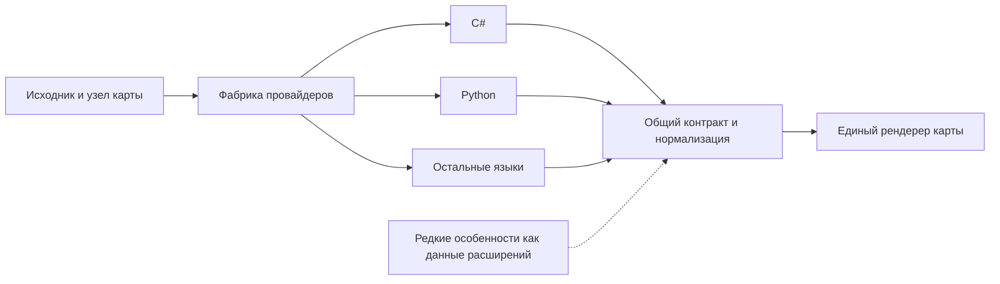

# Фабрика провайдеров дерева кода

Языки отличаются разбором исходника. Карта, навигация, группировка и базовые карточки используют общий результат этого разбора.

`atlas/flow_languages/providers.py` выбирает провайдера по расширению из явного списка. Интерфейс `FlowProvider.describe` одинаков для C# и новых языков. Старый анализатор C# скрыт за `CsharpProvider`; независимые языковые функции `analyze(source,node,max_events=...)` оборачиваются `ModuleProvider`.

Общий host читает только допустимые файлы, применяет бюджет файлов/байтов и добавляет хэши/происхождение. `contract.py` приводит дерево к `atlas-method-flow-v1`: вызов, операция, ожидание, ветвление, цикл, значение, возврат, исключение, break/continue и явно неизвестный шаг. Варианты ветвей остаются вложенными, отложенное выполнение не становится линейным. Рендерер выбирает вид по общему `kind`, не по названию языка.

Для редкой конструкции провайдер оставляет обычную карточку с понятным исходным текстом и может добавить версионированные namespaced `extensions`. Это ограниченные JSON-данные с текстовой подсказкой, не исполняемый код и не отдельный renderer языка. Дополнительное оформление возможно через существующие opt-in декораторы модов. Неизвестное расширение сохраняет базовое отображение; неподдержанная семантика явно обозначается.

Фабрика поддерживает Python, Java, JavaScript, TypeScript/TSX, Go, C++, Kotlin, PHP, Rust, Swift и C#. Общий контракт описывает причины `unsupported`, ограничения парсера и статического анализа, а также диапазоны в исходном коде.

См. [реализацию общего контракта](../atlas/flow_languages/contract.py).
